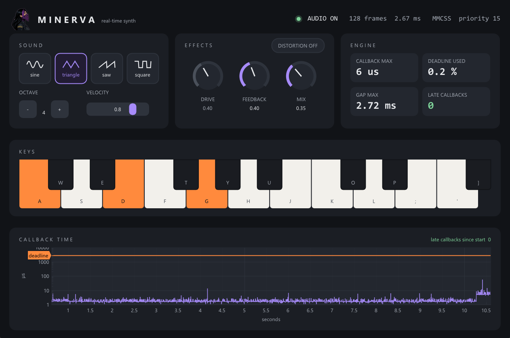
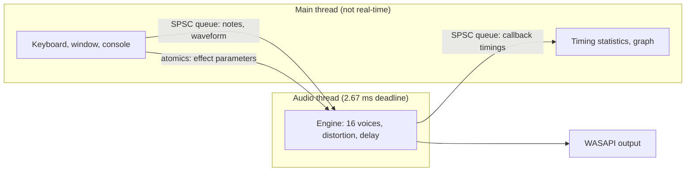
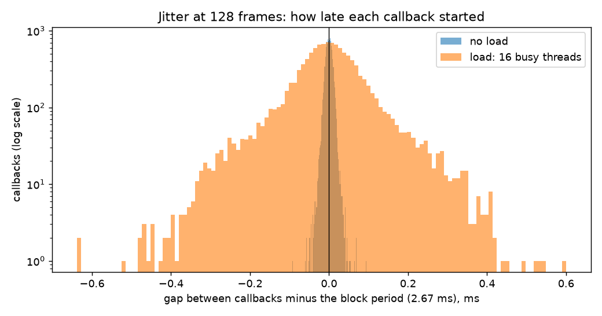

# Minerva

A small real-time synthesizer for Windows, written in C++20: play melodies and
chords from the computer keyboard, through distortion and delay, live into
headphones.

The project is about real-time engineering: a hard deadline every 2.67 ms, no
allocation or locking on the audio thread, lock-free communication between
threads, and measured timing, including under heavy CPU load.



- 16 voices, four waveforms, distortion and delay (oscillators, envelopes and
  effects built on DaisySP).
- A window (Dear ImGui) and a console app that play the same engine.
- Every audio callback is measured and drawn live against its deadline.
- A test fails if the audio path allocates memory.

## Requirements

- Windows 10/11
- Visual Studio 2022 or newer with the C++ workload
- CMake 3.24+
- Git (CMake fetches RtAudio, DaisySP, Dear ImGui, ImPlot and GoogleTest on
  first configure)

## Build

```
cmake -S . -B build
cmake --build build --config Release
```

## Run

Turn the volume down before the first run. There are two apps, which play the
same synth from the same keys.

### The window

```
build\apps\gui\Release\minerva_gui.exe
```

- **SOUND:** the waveform, the octave and the velocity.
- **EFFECTS:** distortion on/off and three knobs (drive, delay feedback, delay
  mix). Turn a knob by circling the mouse around it, clockwise for more.
- **ENGINE:** the last second's callback timing: the slowest callback, the share
  of the deadline it used, the longest gap between callbacks, and late callbacks.
- **KEYS:** the notes the computer keys play, each labelled with its key. They
  light up while held, and the mouse plays them too.
- **CALLBACK TIME:** every callback of the last ten seconds against the deadline,
  on a logarithmic axis (a callback takes microseconds, the deadline is
  milliseconds), and the late callbacks since the start.

The keys light from what the window itself sent to the audio thread, never from
the synth's state, which only the audio thread may touch.

### The console

```
build\apps\cli\Release\minerva_cli.exe
```

### Keys

Both apps play the synth from the computer keyboard, laid out like a piano:

```
 W E   T Y U   O P   ]     black keys
A S D F G H J K L ; '      white keys: C D E F G A B C D E F
```

`A` is middle C. Hold several keys for a chord. The keys are read by position, so
they work whatever the keyboard language is.

Run the console app in a console window (cmd, PowerShell or Windows Terminal).
Terminals embedded in editors, such as VS Code's, pass on characters rather than
keys, so key releases never arrive and notes don't play properly.

| Key | Action |
|---|---|
| `Z` / `X` | octave down / up |
| `C` / `V` | velocity (loudness of the next notes) down / up |
| `1` – `4` | waveform: sine, triangle, saw, square |
| `F7` | distortion on / off (off at start: it makes chords sound harsh) |
| `F1` / `F2` | distortion drive down / up |
| `F3` / `F4` | delay feedback down / up |
| `F5` / `F6` | delay mix down / up |
| `Esc` | quit the console app (Ctrl+C works too); the window closes as usual |

On some keyboards the F keys need the `Fn` key. Effect changes glide over 20 ms, so
they don't click.

Minerva only plays: it opens the speakers or headphones, never the microphone.

### Measuring in the console

Every audio callback is timed. To see the measurements, start the console app
with `--stats`:

```
build\apps\cli\Release\minerva_cli.exe --stats
```

Under CALLBACK TIMING it then adds one row per second:

```
  time |  avg us | p99.9 us |  max us | load % | gap max ms | late | dropped
-------+---------+----------+---------+--------+------------+------+--------
    1s |     2.1 |     10.4 |    10.4 |    0.4 |       2.70 |    0 |       0
    2s |     5.3 |     11.0 |    25.1 |    0.9 |       2.75 |    0 |       0
```

- `avg`, `p99.9`, `max`: how long the callbacks took, in microseconds.
- `load %`: the slowest callback as a share of the deadline, which is one block
  (128 frames at 48 kHz = 2.67 ms). What is left is the headroom.
- `gap max`: the longest time between the starts of two callbacks. Much more than
  one block means something outside the app (the OS, the driver) held the audio
  thread back.
- `late`: callbacks that started more than 1.5 block periods after the previous
  one. A late callback may be a click, but not necessarily: Windows keeps some
  audio queued and may cover the delay. Windows (WASAPI) does not tell an app when
  its output ran dry, so this is the only warning there is.
- `dropped`: timings lost because the display fell behind (the audio thread never
  waits for it). A gap across lost timings does not count as late.

Options for measuring (all optional):

| Option | What it does |
|---|---|
| `--stats` | show the callback timing table |
| `--buffer FRAMES` | block size to ask the device for (default 128) |
| `--load THREADS` | keep the CPU busy with that many threads at normal priority |
| `--csv FILE` | write every callback's timing to a CSV file |
| `--seconds N` | quit after N seconds, for unattended runs |

At startup the AUDIO section shows the audio thread's priority. RtAudio's WASAPI
thread joins MMCSS as "Pro Audio", and it shows as priority 15 (normal threads
are 0).

## How it works



- **The audio thread never waits.** The threads share only lock-free queues and
  atomics. With a mutex, the audio thread could wait for a low-priority thread
  that Windows has paused. If the timing queue is full, the timing is dropped and
  counted.
- **The work per block is bounded.** Voices, buffers and queues are sized before
  the audio starts, and a block takes at most 64 commands.
- **No allocation, tested.** A test replaces `operator new` and `operator delete`,
  plays 20 seconds of busy music, and fails if the audio path calls either.
- **Parameters are smoothed on the audio thread,** so a turned knob doesn't click.
- **Denormals are flushed to zero** (FTZ/DAZ). The delay's fading tail would
  otherwise reach tiny numbers that some CPUs compute far more slowly.
- **The window never reads the synth's state.** Its keys light from what it sent.
  Reading voices the audio thread is changing would be a data race.
- **`core/` has no OS headers,** so the engine is tested without a sound card.

### A bug found by playing it

Sometimes a triangle note turned into booms that never stopped. DaisySP's
oscillator left one field uninitialized, so a voice started from whatever was in
memory. A NaN there entered the delay's feedback and stayed forever. CMake now
patches the library after fetching it, and a regression test builds one voice in
memory filled with zeros and one in memory filled with `0xFF`, and requires
identical sound.

## Experiment: does it hold the deadline under load?

Each row is one 30-second run on a Ryzen 7 7800X3D (8 cores, 16 threads). "Load"
is 16 threads at normal priority that keep every logical processor busy and walk
through memory.

| Block | Deadline | Load | Callbacks | Late | Slowest callback | Longest gap |
|---|---|---|---|---|---|---|
| 128 | 2.67 ms | none | 11,286 | 0 | 18 µs (0.7%) | 2.76 ms |
| 128 | 2.67 ms | 16 threads | 11,646 | 0 | 75 µs (2.8%) | 3.27 ms |
| 256 | 5.33 ms | none | 5,649 | 0 | 16 µs (0.3%) | 5.63 ms |
| 256 | 5.33 ms | 16 threads | 5,648 | 0 | 137 µs (2.6%) | 6.22 ms |
| 512 | 10.67 ms | none | 2,825 | 0 | 130 µs (1.2%) | 10.78 ms |
| 512 | 10.67 ms | 16 threads | 2,833 | 0 | 109 µs (1.0%) | 11.76 ms |



Under load the callbacks start less evenly: at 128 frames the
longest delay grows from about 0.1 ms to 0.6 ms. 1.33 ms would count as late. Bigger
blocks were not needed to hold the deadline, and they add latency.

What this does not show:

- **The synth was silent.** The runs test whether the audio thread gets the CPU
  in time, not the cost of 16 sounding voices.
- **30 seconds can miss rare stalls.**
- **Late is a sign, not proof of a click** (see `late` above).
- **Round-trip latency was not measured.**

To run it again (needs Python with matplotlib: `python -m pip install matplotlib`):

```
python tools/buffer_experiment.py --seconds 30
```

Results go to `results/`. Why it stops at 128 frames: in WASAPI shared mode
Windows mixes every 2.67 ms (128 frames at 48 kHz). Asking for a smaller block
only makes RtAudio split each period into several back-to-back callbacks; the
sound still leaves at the same pace, so latency does not drop. Going lower needs
WASAPI exclusive mode.

## Test

```
ctest --test-dir build -C Release
```

## Layout

```
core/         DSP, effects, synth and timing, portable C++ with no OS headers
backends/     audio device I/O (currently RtAudio over WASAPI)
apps/common/  the key layout and controls both apps share
apps/gui/     the window: Dear ImGui and ImPlot over Direct3D 11
apps/cli/     the console app, with the measurement options
cmake/        patches applied to fetched dependencies
tests/        unit tests
tools/        the buffer-size experiment script
docs/         images for this README
```

## How this was built

I built Minerva with Claude Code, which wrote most of the code, tests and
documentation. I set the direction and scope, made the design decisions, and
tested it by playing. `CLAUDE.md` holds the rules it worked under.

## License

[MIT](LICENSE). The libraries CMake fetches have their own licenses. The logo is
not covered by the MIT license.
